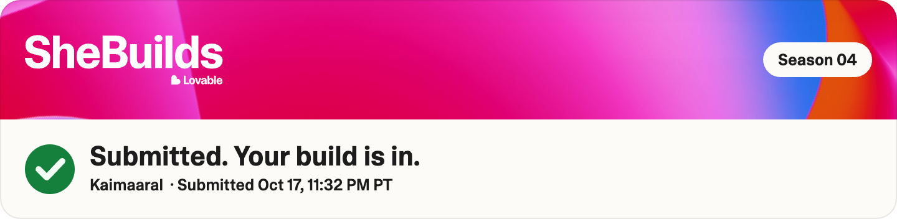

# Kaimaaral, built for SheBuilds Season 04

**Kaimaaral** (കൈമാറൽ, Malayalam for "handover") maps how a specific role actually works, before that knowledge walks out the door.



Selected for SheBuilds Season 04: one of 800 builders accepted out of 3,400 applications. Kaimaaral was submitted to the Business Operations track on October 17, 2026.

Live app: https://kaimaaral.lovable.app

## The problem

In Indian SMEs, the person who runs accounts, sales or dispatch often carries years of judgment in their head. When they leave, that knowledge leaves with them. Most handover tools are English-only, while many employees actually think and talk in Malayalam, Hindi or Tamil.

## What it does

- **Capture**: the role-holder records voice notes, types notes, uploads documents, chat exports, spreadsheets, screen recordings and session videos, in their own language.
- **Map**: AI cross-references every input and extracts real judgment: procedures, decisions, approval rules, contacts and watch-outs. Every item links back to its original source and quote.
- **Visual map**: a three-column handover diagram from the role to categories to individual knowledge items.
- **Review**: the role-holder confirms or corrects what the AI extracted. Nothing changes without approval.
- **Ask**: the successor asks questions and gets answers with source citations.
- **Plan**: a 30-60-90 day onboarding plan made of executable steps, checked for screen paths, decision criteria, approval rules and completion criteria before it can be marked ready.
- **Agents**: Plan builder and Readiness checker runs, tracked with history.
- **Four languages**: English, Malayalam, Hindi and Tamil. The successor picks a reading language; originals are always kept.

## Try it

1. Open the live app and read the **Read Me** page.
2. Create an account and choose your languages.
3. Create the private sample workspace (fictional "Kerala Spices Traders", labeled Sample data).
4. Open a role and follow the guided walkthrough: Map, Ask, Capture, Review, Plan.

## Tech overview

- TanStack Start (React 19, Vite 7), Tailwind CSS v4
- Lovable Cloud for database, auth, storage and row-level security scoped per company
- Lovable AI Gateway for extraction, transcription, translation, Q&A and plans (server-side only)

## Repository layout

```text
src/
  routes/        pages (home, Read Me, sign-in, workspace, role)
  components/    role workspace panels, walkthrough, shared UI
  lib/           AI, translation, plan checks, capture logic
  integrations/  backend client (generated)
  test/          automated tests
drizzle/         database schema and migrations
docs/            setup guide, security review, verification reports, roadmap
public/          static files
```

## Run locally

```bash
bun install
cp .env.example .env   # fill in your backend values
bun run dev            # http://localhost:8080
bunx vitest run        # 36 automated tests
```

The full guide, including database migrations, the file storage area, sign-in providers and troubleshooting, is in [docs/SETUP.md](docs/SETUP.md).

AI features call the Lovable AI Gateway and need a server-side `LOVABLE_API_KEY`.

## Docs

- [Setup guide](docs/SETUP.md)
- [Security review](docs/SECURITY_REVIEW.md)
- [Workflow verification](docs/WORKFLOW_VERIFICATION.md)
- [Submission readiness](docs/SUBMISSION_READINESS.md)
- [Roadmap](docs/roadmap.md)
